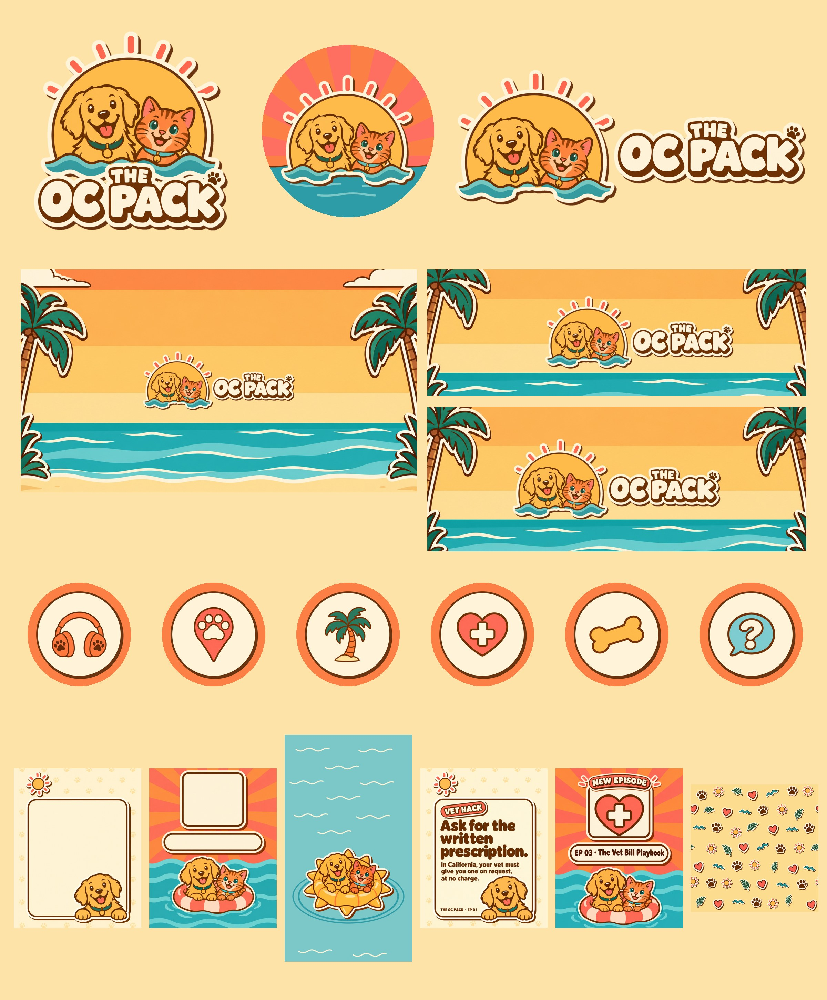

# The OC Pack — Social Style Guide

**System name: Poolside Sticker.** Everything looks like a die-cut vinyl sticker stuck on a sunny SoCal pool deck: bold flat shapes, warm-brown outlines, a cream border, a hard offset shadow. It matches the show page (`src/pages/podcasts/oc-pack.tsx`) and the show's "DJ at the pool" sound (`podcast/shows/oc-pack/show/ART_DIRECTION.md`).



```
       the brand in one picture

   ✺  sun  ✺        ← Gold disc + Coral rays (the logo IS the sun)
  ( 🐶 )( 🐱 )      ← the Pack: golden retriever + orange tabby
 ~~~~~~~~~~~~~~     ← teal wave
  THE OC PACK       ← chunky rounded cream letters, brown outline,
 ▔▔▔▔▔▔▔▔▔▔▔▔▔▔▔       hard brown shadow ↘
```

## 1. What's in the kit

| Folder | File | Size | Use it for |
|---|---|---|---|
| `logo/` | `oc-pack-logo.png` | 1266² transparent | Primary logo: stacked sticker. Merch, decks, partner kits. |
| | `oc-pack-logo-on-sand.jpg` | 1254² | When transparency isn't supported |
| | `oc-pack-lockup-horizontal.png` | 2268×879 transparent | Wide spaces: banners, headers, video end cards |
| | `oc-pack-mark.png` | 1047×879 transparent | The mascots alone (no words): stickers, watermarks, favicons, merch |
| `profile/` | `oc-pack-avatar-1080.jpg` | 1080² | Profile picture on **every** platform (IG, TikTok, YouTube, X, Facebook, Threads) |
| | `oc-pack-avatar-circle-preview.png` | 320² | How the avatar looks once cropped to a circle |
| | `oc-pack-youtube-banner-2560x1440.jpg` | 2560×1440 | YouTube channel art (logo inside the 1546×423 safe area) |
| | `oc-pack-x-header-1500x500.jpg` | 1500×500 | X header |
| | `oc-pack-facebook-cover-1640x624.jpg` | 1640×624 | Facebook Page cover (logo survives the mobile crop) |
| `highlights/` | `oc-pack-highlight-{episodes,local,beaches,health,training,ask}.jpg` | 1080×1920 | Instagram Story highlight covers |
| `templates/` | `oc-pack-tip-card-1080x1350.jpg` | 4:5 | Blank plate for tips and facts |
| | `oc-pack-episode-drop-1080x1350.jpg` | 4:5 | Blank plate for new-episode posts |
| | `oc-pack-story-reel-cover-1080x1920.jpg` | 9:16 | Blank plate for Story frames and Reel/TikTok/Shorts covers |
| | `oc-pack-pattern-tile.jpg` | 1024² seamless | Backgrounds, stickers sheets, merch fills |
| `examples/` | `oc-pack-example-{tip-card,episode-drop}.jpg` | 1080×1350 | The templates in use, upload-ready |
| `tools/` | `gen.py`, `codex-style.txt`, `master-logo.png`, `build/` | | Make new on-brand art with Codex and rebuild lockups from the master (see §9) |

The **podcast feed cover** (`public/podcasts/oc-pack/cover.jpg`) is unchanged. The one-series-cover rule in `ART_DIRECTION.md` stands; replacing it with the new logo is Long's call.

## 2. Logo

```
 Primary (stacked)      Horizontal lockup              Mark            Avatar
 ┌───────────┐          ┌───────────────────────┐     ┌─────────┐     ╭─────────╮
 │  ✺ 🐶🐱 ✺  │          │ ✺🐶🐱✺     THE         │     │ ✺ 🐶🐱 ✺ │     │ ╲ ✺🐶🐱 ╱│ sunburst
 │ ~~~~~~~~~ │          │ ~~~~~~   OC PACK 🐾    │     │ ~~~~~~~ │     │ ~~~~~~~ │ sea
 │  THE      │          └───────────────────────┘     └─────────┘     ╰─────────╯
 │ OC PACK 🐾│          wide slots ≥ 2.5:1             no words        circles
 └───────────┘
 square slots

 One master drawing: every lockup, the mark and the avatar are cut from the SAME
 art (tools/master-logo.png) and get a code-drawn die-cut border, so the mascots
 never drift between assets.
```

| Rule | Value |
|---|---|
| Clear space | The height of the "THE" letters, on every side |
| Sun | One large disc that fully contains both pets (nothing pokes past its edge), 7 rays. Keeps the mark calm: pets read as one unit. |
| Sticker border | 22px cream die-cut + hard brown shadow offset 14px right / 16px down (at master scale), never blurred |
| Minimum size | Primary 160px wide · Lockup 260px wide · Below that, use the mark or avatar |
| Backgrounds | Any palette colour, the pattern, or a calm photo. The cream die-cut border is what separates it, so never remove it. |
| Words | Always "THE OC PACK", all caps in the logo. In sentences: "The OC Pack". |

**Never:** recolour the mascots, swap the pets, stretch or rotate the logo, add a drop-blur or glow, redraw the letters in another font, put the words on the avatar, crop the sun rays, or regenerate the logo mascots with AI (cut them from the master instead).

## 3. Colour

The web palette, unchanged. **Brown is the ink**: every outline and almost all text.

| Name | Hex | Role |
|---|---|---|
| Brown ink | `#6B3410` | Outlines, body text, hard shadows. Never use pure black. |
| Cream | `#FFF4DA` | Sticker borders, text panels, display letters |
| Sand | `#FDE3A7` | Default canvas |
| Sunset | `#FC7F46` | Hero colour: highlights bg, sunbursts, kicker text on big art |
| Coral | `#FF6F61` | Sun rays, labels, hearts. Pink-coral, never red. |
| Gold | `#FEBB55` | Sun, the dog, floats |
| Ocean teal | `#2E9CA6` | Water |
| Lagoon | `#7CC8C8` | Water highlights, Ask the Pack |
| Palm | `#1F6B5C` | Palm fronds, dark accent text |

**Contrast (checked):**

| Text | On | Ratio | OK for |
|---|---|---|---|
| Brown | Cream | 9.0:1 | everything |
| Brown | Sand | 7.9:1 | everything |
| Brown | Gold | 5.9:1 | everything |
| Brown | Lagoon | 5.2:1 | everything |
| Palm | Cream | 5.8:1 | everything |
| Brown | Sunset | 3.9:1 | headlines ≥ 24px only |
| Cream | Sunset / Coral / Teal | 2.3–3.0:1 | **never as plain text.** Only as chunky letters with a brown outline + shadow (the outline carries the contrast) |

## 4. Type

| Role | Font | Style |
|---|---|---|
| Display / headlines | **Titan One** (Google Fonts, same as the site) | 1–7 words. Brown on light; on colour, cream with a brown outline and a hard brown shadow ↘ |
| Body / captions | **Nunito** ExtraBold 800 (Bold 700 for long lines) | Brown, sentence case, ≤ 2 short lines on a graphic |
| Labels / kickers | Nunito Black 900, caps, +5% tracking | In a Coral or Sunset pill with cream text + brown outline |

Burned-in video captions: Nunito Black, cream fill, 6px brown stroke, max 2 lines, centred in the lower third but above the platform UI (see §7).

## 5. Illustration rules

- Flat vector. One flat shade per shape at most. No gradients, textures, glows, 3D or photo-real.
- Uniform medium-thick brown outline with rounded joins on **every** shape.
- Cream die-cut border + hard brown offset shadow (down-right, no blur) on anything that's a "sticker".
- Motifs: sun, palm fronds, wavy water, paw prints, pool floats, beach. **Use 2–3 per image, not all of them.**
- One focal subject per image. Leave calm space for words.

**The Pack (mascots):**

| | Dog | Cat |
|---|---|---|
| Look | Golden retriever, Gold fur, open smile, pink tongue | Orange tabby, Sunset fur, darker stripes, green eyes |
| Wears | Palm-green collar, round gold tag | Teal collar, small gold bell |
| Props allowed | Pool float only. No sunglasses, hats or costumes on brand assets (they read as a different character at small sizes). | Same |

They stay unnamed for now, and both are always happy and friendly. The dog can appear solo on tip cards; the brand moments (logo, avatar, episode drops) always show both. **Show the pair once per image**: never the logo mascots and a second posed pair in the same frame, and never next to the old feed-cover drawings.

## 6. Content pillars → visuals

Each pillar has a highlight icon: **one object**, the same brown outline weight, normalised to equal visual weight on an identical code-drawn disc (900px cream disc, 18px brown ring, hard brown shadow 12px right / 14px down, on Sunset). Use it as a small sticker on posts in that pillar, or large in the episode-drop frame, so the grid stays organised.

| Pillar | Highlight | Icon | Label pill text |
|---|---|---|---|
| Episodes | Episodes | headphones with paw cups | NEW EPISODE |
| Local intel | Local | paw map pin | OC LOCAL |
| Beaches & outdoors | Beaches | palm tree on a sand mound | BEACH DAY |
| Health & safety / Money savers | Health | heart with a cross | VET HACK / SAFETY |
| Training | Training | bone treat | TRAINING |
| Community / listener Qs | Ask | question bubble | ASK THE PACK |

## 7. Platform specs and safe zones

Platforms change these, so check the current spec before uploading.

| Platform | Asset | Size | Safe zone |
|---|---|---|---|
| All | Avatar | 1080² upload | Shown as a circle at ~110px. Keep detail in the centre 70%. |
| Instagram | Feed post | 1080×1350 (4:5) | Profile grid crops to 3:4, so keep text inside the centre 1012px width |
| Instagram / TikTok / Shorts | Story, Reel, cover | 1080×1920 | No text in the top 250px or bottom 340px; keep 120px clear on the right for Reel buttons |
| Instagram | Highlight cover | 1080×1920 | Only the centre circle shows |
| YouTube | Channel banner | 2560×1440, ≤ 6 MB | Logo/text inside the centre 1546×423 |
| X | Header | 1500×500 | Avatar covers the bottom-left, so start the logo past 30% of the width |
| Facebook | Page cover | 1640×624 | Mobile crops the sides. Keep the logo in the centre ~1100px. |

```
 Story / Reel 1080×1920
 ┌──────────────┐
 │▒▒ 250px UI ▒▒│
 │  HEADLINE    │ ← Titan One, top third
 │  sub line    │
 │              │
 │   🐶🐱 art   │ ← mascots / clip / cover
 │  captions  ▕▒│ ← right 120px: buttons
 │▒▒ 340px UI ▒▒│
 └──────────────┘
```

## 8. Post recipes

```
 TIP CARD (4:5)                 EPISODE DROP (4:5)
 ┌─────────────────┐            ┌─────────────────┐
 │☀  (paw pattern) │            │ ┌─[NEW EPISODE]─┐│ ← coral pill on frame edge
 │ ┌─────────────┐ │            │ │  topic icon  ││ ← the pillar's icon
 │ │[VET HACK]   │ │← pill      │ └──────────────┘│
 │ │Headline in  │ │← Titan     │  └───────────┘  │
 │ │3 lines max. │ │            │ ( EP 03 Title ) │ ← pill, brown Titan
 │ │body ≤2 lines│ │← Nunito    │🐶🐱 float ~~~~~~ │
 │ │THE OC PACK·EP│🐶│          └─────────────────┘
 │ └─────────────┘ │
 └─────────────────┘
```

- **Tip card:** one fact per card. Footer `THE OC PACK · EP NN` names the episode it comes from.
- **Episode drop:** the feed title exactly as published (e.g. "EP 03 · The Vet Bill Playbook"). The frame holds the episode's pillar icon, not the feed cover (the cover's older drawings would put two different mascot styles in one image).
- **Clip (Reel/Short/TikTok):** hook in the first 2 seconds, burned-in captions (§4), story-cover plate as the cover frame, horizontal lockup as a 1-second end card.
- **Carousel:** slide 1 is a tip card headline; inner slides use the tip-card plate; the last slide is an episode drop.

**Accuracy gate:** every fact on a graphic must already be a `keep` row in that episode's `claims.md` (see `INFO_STANDARDS.md`). The tip example uses Ep 1 claim 12. No row, no post.

**Captions and voice:** warm local friend, plain words, emoji welcome (🐾 ☀️ 🌴 🌊). Geo-tag the OC city, and use 3–5 local hashtags. End with "Produced by The Joy Digi" in bios and the YouTube About section. Never write "by Long La".

## 9. Making new assets with Codex

All illustration in this kit was generated by Codex's built-in image tool (`gpt-5.6-sol`, ChatGPT auth, no API key). Layout, borders, discs, sunburst, sea, pattern repeat and crops are done in code (`tools/build/`) so they're exact and repeatable.

```bash
python3 docs/brand/social/oc-pack/tools/gen.py hl-events "Instagram highlight cover icon: Sunset background, cream circle, a calendar with a paw print" -r docs/brand/social/oc-pack/tools/master-logo.png -o /tmp/oc-pack-art
```

- `codex-style.txt` is the mandatory style block; it's appended to every prompt. Edit it there and nowhere else.
- Always pass the logo as `-r` so the mascots stay on-model.
- Run one image per `codex exec` (they stall when batched), in parallel. Each takes ~60s.
- Ask for **no lettering** on plates; add words in Canva/Figma with Titan One + Nunito. Codex spells short text correctly, but check every letter.
- Need the logo in a new shape (square sticker, vertical, merch)? Don't regenerate it. Run `tools/build/parts.py tools/master-logo.png parts.pkl`, then compose from the parts like `tools/build/compose.py` does.
- Need something keyed (a new mascot pose)? Ask Codex for it on a flat `#00FF00` background and cut it out (see `tools/build/story.py`).
- Art review rule: generate options, keep only the strongest, and show Long finished work only.

## 10. QA checklist (run before anything ships)

Every file in this kit passed this list, with two review passes: a pixel-level check plus an independent Codex visual review, then fixes, then a second Codex pass.

| Check | How |
|---|---|
| Spelling | Read every letter at 100%. |
| Mascots on-model | Logo-family assets are cut from the master, and poses match its faces, collars, tag and bell. One pair per image. |
| Flat colour | No ramps. Measured noise in flat fills is under 1/255. No black, grey or purple pixels (automated audit). |
| Cutouts | Check on white, palm green and near-black at 2× zoom. No halo. |
| Crops and safe zones | Nothing important touches an edge. Simulate the avatar circle at 110/48px, the X avatar overlap, Facebook mobile, YouTube 1546×423, the IG 3:4 grid, and the Story UI zones. |
| Small sizes | Highlights read at 64px, the avatar at 48px, the lockup at 260px. |
| Repeats | The pattern tile must be seamless (edge difference ≈ 0) when tiled 2×2. |
